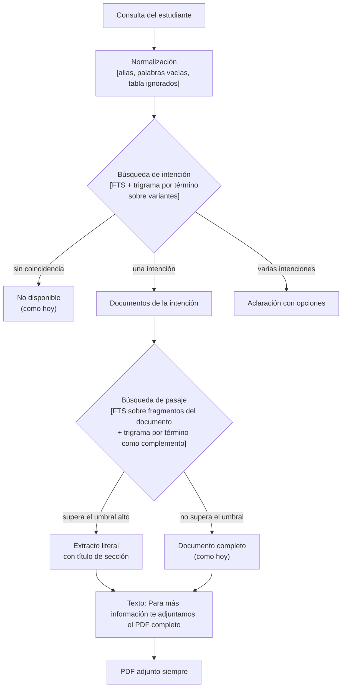
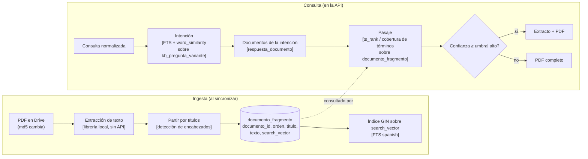

# 08 · Extractos de documentos

**Estado:** implementada en su primera versión: la sincronización extrae las secciones de los PDFs de Drive, y el chat muestra extractos en las consultas de texto libre. Las decisiones están en [Decisiones](#decisiones). Cuando se valide, se pasan a [07-contenido-y-decisiones.md](07-contenido-y-decisiones.md).

## Idea

Hoy, una consulta que coincide con una intención muestra la respuesta curada de la planilla y adjunta el documento. La propuesta es que la respuesta incluya un **extracto literal** del documento que responde la pregunta concreta, por ejemplo las condiciones para promocionar o para regularizar.

Ejemplo de respuesta esperada:

> Para promocionar Administración de Bases de Datos necesitás una calificación de 7 (siete) en cada una de las 2 evaluaciones parciales, entregar el 75% de las PFO en primera fecha de entrega y aprobar el 75% de las PFO. Para regularizar, debés haber aprobado con un mínimo de nota 4 (cuatro) los dos exámenes parciales.
>
> Para más información te adjuntamos el PDF completo.
>
> `ABD_condiciones_2026_1C.pdf`

El texto del extracto sale del documento vigente. Nada se parafrasea ni se genera.

## Dos búsquedas distintas

| Búsqueda | Qué compara | Qué devuelve | Estado |
|---|---|---|---|
| **Intención** | La pregunta contra variantes escritas por el equipo (textos cortos) | Una intención y su opción de menú | Implementada |
| **Pasaje** | La pregunta contra fragmentos del texto de los documentos de esa intención | El fragmento que responde, con su título | Implementada |

## Flujo funcional

Los pasos que ve el estudiante. Cada paso indica entre corchetes la técnica que lo resuelve.

## Flujo técnico

Dónde vive cada paso. Esto es lo que se construye en cada parte.

## Conceptos técnicos por componente

| Componente | Concepto | Dónde se aplica | Tabla o índice |
|---|---|---|---|
| Intención | FTS en español, cobertura de términos, trigramas por término | Variantes de preguntas, textos cortos | `kb_pregunta_variante` (`search_vector`, índice trigram) |
| Pasaje | FTS en español, cobertura de términos | Texto de cada sección de un documento | `documento_fragmento` (`search_vector`, GIN) |
| Pasaje, complemento | Trigramas por término (`word_similarity`) | Errores de tipeo en los fragmentos | Índice trigram sobre `texto` o sobre `titulo` |
| Umbral | Confianza mínima sobre el promedio de cobertura | Pasaje: umbral alto, inicialmente 0,9 | Configurable por entorno |
| Extracción | Texto literal del PDF, sin generación | Ingesta | Ninguna: el texto se guarda tal cual |

**Por qué FTS para fragmentos:** un fragmento de sección puede tener cientos de palabras. `tsvector` está pensado para textos de cualquier largo, con stemming y stopwords del idioma. Los trigramas sobre párrafos largos pierden precisión, así que se usan solo como complemento para errores de tipeo.

## Decisiones

1. **Entran todos los documentos posibles.** Si un formato no se extrae bien, se ajusta el documento, caso por caso.
2. **Tabla de fragmentos basada en FTS.** Cada fragmento guarda su título y su texto. Se busca con el mismo criterio de cobertura de términos que las intenciones, y los trigramas quedan como complemento. La relación es de un documento a muchos fragmentos; la confirmación del 1:1 está pendiente (ver preguntas abiertas).
3. **PDFs de Genially: fuera por ahora.** Se muestran solo desde el menú, no por texto libre. Se revisan cuando sean prioritarios.
4. **Un extracto por consulta, con los dos mejores fragmentos si aplica.** El caso de respuestas repartidas en varias secciones se revisa si aparece en la práctica.
5. **Umbral alto para empezar (0,9).** Se ajusta con el conjunto dorado y los logs de consultas reales. Variable: `KB_UMBRAL_PASAJE`.
6. **Los extractos son solo para texto libre.** El camino de menú sigue mostrando el documento completo, como antes.
7. **Documentos sin texto extraíble, fuera.** `GENERAL_reglamento` y `GENERAL_protocolo-examenes` son imágenes. El OCR da resultados que no sirven para citar, así que no se usa: se le pide al cliente un PDF con texto seleccionable.
8. **Sin reprocesar lo que no cambió.** La sincronización compara el `md5` del archivo con `documento.fragmentos_md5`, y solo descarga y extrae cuando difieren.

## Preguntas abiertas

1. ¿La relación es 1 documento a N fragmentos? Un documento con varias secciones necesita varios fragmentos.
2. ¿Quién aprueba los fragmentos, y cómo se guarda esa aprobación?
3. ¿Qué documentos entran primero? Por ahora, los prioritarios; el resto cuando se necesiten.

