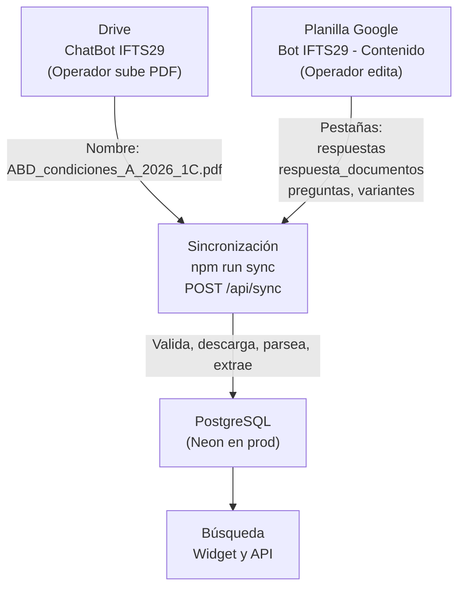
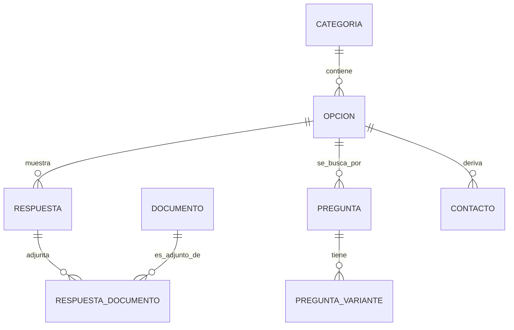

# 8. Flujo de Contenido y Documentos

Esquema visual y técnico del flujo completo: cómo el operador carga contenido, cómo el sistema lo procesa, y cómo se vinculan todas las piezas.

---

## Flujo General



---

## Sistema de Claves y Referencias

Cada entidad tiene una **clave única** que la identifica. Las otras tablas la referencian por esa clave.



**Ejemplo concreto:**

```
CATEGORÍA
  clave: RAIZ
  nombre: Inicio
  
    ↓ (referencia: categoria_id = RAIZ)
    
OPCIÓN (del menú)
  clave: RAIZ_OP_MATERIAS
  categoria: RAIZ
  tipo: navegar
  destino: MATERIAS
  
    ↓ (si tipo = 'responder', referencia: respuesta_id)
    
RESPUESTA
  clave: ABD_condiciones
  texto: Estas son las condiciones para aprobar ABD...
  
    ↓ (referencia en respuesta_documentos)
    
RESPUESTA_DOCUMENTO
  respuesta: ABD_condiciones
  documento: ABD_condiciones_A_2026_1C  (sin .pdf)
  
    ↓ (nombre del archivo parsea a:)
    
DOCUMENTO
  clave: abd_condiciones_a_2026_1c
  materia: ABD
  tipo: condiciones
  comision: A
  anio: 2026
  cuatrimestre: 1C
  drive_file_id: <ID de Drive>
  
    ↓ (sincronización extrae)
    
DOCUMENTO_FRAGMENTO
  titulo: "Requisitos de Aprobación"
  texto: "Debes aprobar dos parciales con 7..."
  search_vector: (generado automáticamente)
```

---

## Convención de Nombres de Documentos

Los metadatos se leen **del nombre del archivo**, no de una base de datos.

**Formato:**
```
<CódigoMateria>_<Tipo>[_<Comisión>]_<Año>[_<CuatrimestreDeCursada>].pdf
```

| Componente | Ejemplo | Notas |
|---|---|---|
| **CódigoMateria** | `ABD`, `EAM`, `LC`, `GENERAL` | Mayúsculas. `GENERAL` para documentos sin materia |
| **Tipo** | `programa`, `condiciones`, `cronograma`, `horarios` | Con guiones si es compuesto: `entrega-documentacion` |
| **Comisión** | `A`, `B`, `General` | Opcional. Sólo si el documento depende de comisión |
| **Año** | `2026` | Define si está actualizado |
| **Cuatrimestre** | `1C`, `2C` | Opcional. Ubicación dentro del plan, no fecha. `GENERAL` no lo lleva |

**Ejemplos válidos:**
```
ABD_cronograma_2026_1C.pdf
ABD_condiciones_A_2026_1C.pdf
EAM_programa_2026.pdf
GENERAL_reglamento_2026.pdf
LC_horarios_B_2026_2C.pdf
GENERAL_protocolo-examenes_2026.pdf
```

**Ejemplos inválidos (no se cargan):**
```
abd_condiciones.pdf              ← Faltan año y cuatrimestre
ABD_condiciones_2026_1C_v2.pdf   ← No parsea (hay "v2")
CONDICIONES_ABD_A_2026.pdf       ← Orden incorrecto
```

---

## Pestañas de la Planilla

Cada pestaña contiene datos que el operador edita. El sistema valida referencias antes de escribir.

### Estructura del Menú

| Pestaña | Campos | Ejemplo | Notas |
|---|---|---|---|
| `categorias` | clave, nombre, mensaje, orden, es_raiz | `RAIZ`, `Inicio`, `Hola`, `0`, `TRUE` | `es_raiz=TRUE` solo para la pantalla inicial |
| `opciones` | clave, categoria, etiqueta, tipo, destino, respuesta, orden, es_volver | `RAIZ_OP_MAT`, `RAIZ`, `Materias`, `navegar`, `MATERIAS`, ` `, `1`, `FALSE` | `tipo`: navegar/responder/derivar |
| `respuestas` | clave, texto, orden | `ABD_prog`, `Estas son las condiciones...`, `1` | Texto institucional validado |

### Vincular Respuestas con Documentos

| Pestaña | Campos | Ejemplo | Notas |
|---|---|---|---|
| `respuesta_documentos` | respuesta, documento, orden | `ABD_condiciones`, `ABD_condiciones_A_2026_1C`, `1` | `documento` = nombre del archivo **SIN** `.pdf` |

### Base de Conocimiento (Búsqueda de Texto Libre)

| Pestaña | Campos | Ejemplo | Notas |
|---|---|---|---|
| `preguntas` | opcion, pregunta, prioridad, umbral_minimo | `ABD_CONDICIONES`, `¿Cuáles son las condiciones?`, `30`, `0.7` | La opción es el destino donde aparece esta pregunta |
| `variantes` | opcion, pregunta, texto_original, peso | `ABD_CONDICIONES`, `¿Cuáles son...?`, `condiciones para aprobar abd`, `1` | Formas alternativas de preguntar |
| `equivalentes` | alias, expansion | `abd`, `administracion de bases de datos` | Se expande en consultas y variantes |
| `ignorados` | termino | `como`, `para`, `una` | Se quita al buscar (no en índice) |
| `palabras_vacias` | termino | `de`, `la`, `y` | Se quita en consultas y variantes |
| `reconocimiento_fragmentos` | termino | `bibliografia`, `requisitos`, `condiciones` | Títulos que dividen el PDF en fragmentos |

### Derivación

| Pestaña | Campos | Ejemplo | Notas |
|---|---|---|---|
| `contactos` | clave, nombre, area, comision, email, url_perfil, motivo, orden, opcion | `bedelia`, `Bedelía`, `Bedelía`, `General`, `bedelia@bue.edu.ar`, ` `, `Trámites`, `3`, `DERIVACION_OP_TRAMITES` | `opcion` = a qué botón de derivación pertenece |

---

## Ejemplo Completo: Agregar "Condiciones para ABD"

### 1. Subir PDF a Drive

**Archivo:** `ABD_condiciones_A_2026_1C.pdf`
- Materia: ABD
- Tipo: condiciones
- Comisión: A
- Año: 2026
- Cuatrimestre: 1C

### 2. Actualizar Planilla

**Pestaña `respuestas`** (si no existe):
```
clave: ABD_condiciones
texto: Estas son las condiciones para aprobar Administración de Bases de Datos (ABD). Para aprobar necesitás una calificación de 7 (siete) en cada una de las 2 evaluaciones parciales...
orden: 1
```

**Pestaña `respuesta_documentos`**:
```
respuesta: ABD_condiciones
documento: ABD_condiciones_A_2026_1C
orden: 1
```

⚠️ El nombre **SIN** `.pdf`.

**Pestaña `preguntas`** (para búsqueda):
```
opcion: ABD_CONDICIONES
pregunta: ¿Cuáles son las condiciones para aprobar ABD?
prioridad: 30
umbral_minimo: 0.7
```

**Pestaña `variantes`** (formas de preguntar):
```
opcion: ABD_CONDICIONES
pregunta: ¿Cuáles son las condiciones para aprobar ABD?
texto_original: condiciones para aprobar abd
peso: 1

opcion: ABD_CONDICIONES
pregunta: ¿Cuáles son las condiciones para aprobar ABD?
texto_original: como apruebo abd
peso: 0.8

opcion: ABD_CONDICIONES
pregunta: ¿Cuáles son las condiciones para aprobar ABD?
texto_original: requisitos de aprobacion
peso: 1
```

### 3. Sincronizar

```bash
npm run sync --workspace backend
```

### 4. Sistema Procesa Automáticamente

- **Descarga:** Lee el PDF de Drive por `drive_file_id`
- **Parsea nombre:** Extrae materia=ABD, tipo=condiciones, comision=A, año=2026, cuatrimestre=1C
- **Valida referencias:**
  - `respuesta: ABD_condiciones` existe en `respuestas` ✓
  - `documento: ABD_condiciones_A_2026_1C` existe en Drive ✓
  - `opcion: ABD_CONDICIONES` existe en `opciones` ✓
- **Extrae fragmentos:** Lee el PDF, divide por títulos, genera índices
- **Crea índices:** `search_vector` para búsqueda full-text

Si hay errores en las referencias, la sync **no escribe nada** y devuelve la lista.

---

## Convención de Claves

**Objetivo:** Identificar de qué es cada cosa, sin ambigüedad.

### Patrones recomendados

| Entidad | Patrón | Ejemplo |
|---|---|---|
| Categoría raíz | `RAIZ` | `RAIZ` |
| Categoría | `<DESCRIPCIÓN>` | `MATERIAS`, `DERIVACION`, `INFORMACION` |
| Opción | `<CATEGORÍA>_OP_<DESCRIPCIÓN>` o `<CODIGO_MATERIA>_<TIPO>` | `RAIZ_OP_MATERIAS`, `ABD_CONDICIONES` |
| Respuesta | `<CODIGO_MATERIA>_<TIPO>` o `<DESCRIPCIÓN>` | `ABD_programa`, `ABD_condiciones`, `DERIVACION_GENERAL` |
| Contacto | `<nombre_corto>` | `bedelia`, `coordinacion`, `secretaria` |
| Derivación (opción) | `DERIVACION_<MOTIVO>` | `DERIVACION_OP_TRAMITES`, `DERIVACION_OP_CONSULTAS` |

### Reglas

- **MAYÚSCULAS** para que sea obvio que es una clave
- **Sin espacios.** Usar guiones bajos: `ABD_CONDICIONES`, no `ABD CONDICIONES`
- **Descriptivo:** La clave debe indicar a qué se refiere, no ser `X1`, `OPC2`, etc.
- **Consistente:** Si una materia es `ABD`, úsalo siempre; no mezcles `ABD`, `abd`, `Administracion_BD`

### Ejemplos malos

```
X123                    ← No indica a qué se refiere
material 1              ← Tiene espacio
abd_programa            ← Mezcla minúsculas (inconsistente con el resto)
CONDICIONES_PARA_APROBAR_ABD_2026_COMISION_A  ← Demasiado largo
```

---

## Flujo de Validación

Antes de escribir, la sincronización valida:

1. **Encabezados:** Cada pestaña tiene exactamente los campos esperados, en el orden correcto
2. **Referencias:**
   - `opciones.categoria` → existe en `categorias.clave` ✓
   - `opciones.destino` → existe en `categorias.clave` ✓
   - `opciones.respuesta` → existe en `respuestas.clave` ✓
   - `respuesta_documentos.respuesta` → existe en `respuestas.clave` ✓
   - `respuesta_documentos.documento` → existe en Drive ✓
   - `preguntas.opcion` → existe en `opciones.clave` ✓
   - `variantes.opcion` → existe en `opciones.clave` ✓
   - `contactos.opcion` → existe en `opciones.clave` ✓
3. **Tipos:**
   - `opciones.tipo` ∈ {navegar, responder, derivar}
   - `categorias.es_raiz` ∈ {TRUE, FALSE}
4. **Lógica:**
   - Si `tipo=navegar`: debe tener `destino`, no `respuesta`
   - Si `tipo=responder`: debe tener `respuesta`, no `destino`
   - Si `tipo=derivar`: no requiere `destino` ni `respuesta`

Si alguna validación falla: devuelve **todos los errores juntos** y **no cambia nada en la BD**.

---

## Qué Popula el Sistema (No Editable)

Estas tablas se generan automáticamente durante la sincronización:

| Tabla | Cómo se llena |
|---|---|
| `documento` | Descargado de Drive, nombre parseado |
| `documento_fragmento` | Extraído del PDF por títulos de sección |
| `metrica_opcion` | Por uso del widget (no toca sync) |
| `metrica_exportacion` | Por exportación mensual de métricas |

**Campos que se calculan:**
- `documento.materia`, `tipo`, `comision`, `anio`, `cuatrimestre`: parseados del nombre
- `documento.drive_file_id`: ID único de Drive
- `documento.drive_md5`: checksum del archivo, para detectar cambios
- `documento.fragmentos_md5`: checksum para saber si re-extraer fragmentos
- `documento_fragmento.search_vector`: generado automáticamente desde `texto_busqueda`

---

## Checklist: Antes de Sincronizar

- [ ] PDF subido a Drive con nombre correcto (`MATERIA_tipo[_comision]_año[_cuatrimestre].pdf`)
- [ ] Entrada en `respuesta_documentos` con `documento = nombre_sin_.pdf`
- [ ] Respuesta existe en `respuestas.clave` ↔ `respuesta_documentos.respuesta`
- [ ] Opción existe en `opciones.clave` ↔ `preguntas.opcion` y `variantes.opcion` (si aplica)
- [ ] Claves son MAYÚSCULAS y descriptivas
- [ ] Ningún campo vacío donde no debería estar
- [ ] Orden de columnas es exacto (la sync valida esto)

Si algo falla, la respuesta te dice exactamente qué está mal.

---

**Referencia:** [3. Manual Operacional](03-manual-operacional.md) para instrucciones paso a paso.
